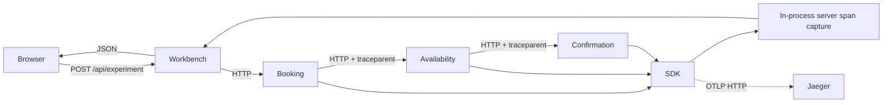

# Architecture and data flow

## Stack and topology

Go standard-library HTTP servers, OpenTelemetry Go SDK and HTTP instrumentation, embedded HTML/CSS/JavaScript, optional Jaeger via Docker Compose. One Go process owns the workbench and three independent loopback listeners with service-specific tracer providers. The three services communicate through actual HTTP requests. This keeps setup light while preserving the trace context and the network boundaries needed for the exercise.

## Request and measurement flow

The workbench sends sequential booking requests. Booking calls Availability, which calls Confirmation. Each service emits server spans and the outgoing clients propagate W3C Trace Context. Availability applies a fixed delay during the slow phase. The workbench measures elapsed time for each booking request and computes sample median and nearest-rank p95 per phase. The response includes all elapsed times and the three captured service spans for every request. With nine samples, nearest-rank p95 is the largest observed value. This is a controlled demonstration, not a production load test.

## Storage and data contract

No database. A single bounded run captures at most 81 server spans in memory, keyed by trace ID, and clears them on completion. The browser holds the latest successful experiment until reload. Each phase includes its ID, p50, p95 and samples. Each sample includes elapsed time, trace ID and spans. Span records carry service, ID, parent ID, offset and duration. Jaeger optionally receives full spans via OTLP and holds them in its development storage.

## Security and failure handling

Bind every listener to loopback. The experiment endpoint requires POST with a custom header, which blocks ordinary cross-origin form submissions. Serve no CORS grants and accept only the configured loopback Host header. Each service accepts its exact route and checks a random per-launch credential before tracing. The workbench accepts an empty request body. HTTP read and idle deadlines, a fixed workload, and a single active experiment bound resource use. Internal clients connect directly and do not follow redirects. Service URLs and delay are selected internally. The browser renders labels with DOM text APIs. A failed request aborts the run and releases the guard. No user credentials or personal data are collected.

## Shutdown

SIGINT and SIGTERM stop the workbench from accepting new connections. The launcher gives an active experiment up to 16 seconds to finish, then closes the internal HTTP servers and tracer providers before flushing the shared exporter.
